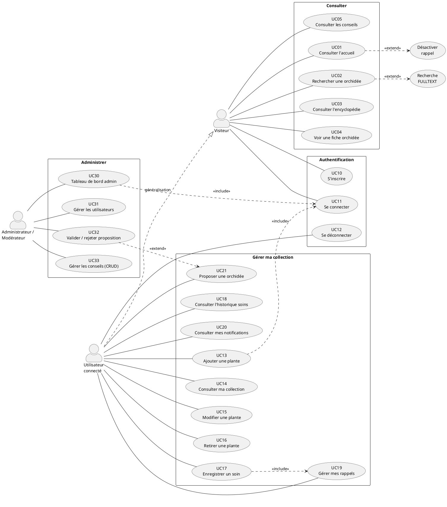

# Diagramme de cas d'utilisation — Mes Orchidées

> **Version** : 2.0 — corrigé pour le 3ᵉ oral DWWM
> **Format source** : PlantUML (`.puml`) — rendu à générer via [plantuml.com](https://plantuml.com) ou l'extension VS Code *PlantUML*
> **Fichier source** : `docs/oral-prep/02-uml-cas-utilisation.puml`

---

## Corrections apportées par rapport à la version orale-2

| Problème signalé | Correction |
|---|---|
| Associations tracées avec des flèches | Lignes simples sans flèche entre acteur et cas (convention UML) |
| Relations `extend` qui se croisent | Réorganisation spatiale : étiquettes `<<extend>>` orientées vers le cas de base, sans croisement |
| Acteurs non pertinents / manquants | 3 acteurs seulement : **Visiteur**, **Utilisateur connecté**, **Administrateur** |
| Cas d'utilisation non alignés avec le code réel | Chaque CU correspond à une route ou un contrôleur réellement implémenté |
| Généralisations absentes | `Utilisateur connecté` hérite de `Visiteur` (généralisation `──▷`) |

---

## Acteurs

| Acteur | Description | Preuve code |
|---|---|---|
| **Visiteur** | Toute personne accédant au site sans session active | Routes sans `grant` dans `config/routes.php` |
| **Utilisateur connecté** | Membre inscrit avec une session PHP active | `SessionGrantChecker::isGranted('user')` |
| **Administrateur** | Utilisateur avec `role IN ('admin','moderateur')` | `AuthController.php:103` — rôle jamais créable en public |

**Généralisation** : `Utilisateur connecté ──▷ Visiteur` — un utilisateur connecté hérite de toutes les capacités du visiteur.

---

## Cas d'utilisation (UC)

### Paquet « Consulter » (accessible sans auth)

| CU | Description | Contrôleur |
|---|---|---|
| `UC01` Consulter l'accueil | Page d'accueil, mots flottants, barre de recherche | `HomeController::index()` |
| `UC02` Rechercher une orchidée | FULLTEXT + repli LIKE sur `orchids` | `EncyclopedieController::search()` |
| `UC03` Consulter l'encyclopédie | Liste des 21 espèces publiées | `EncyclopedieController::index()` |
| `UC04` Voir une fiche orchidée | Détail espèce + bouton `+ Collection` | `OrchidController::show()` |
| `UC05` Consulter les conseils | Liste + modale de lecture | `ConseilController::index()` |

### Paquet « Gérer ma collection » (utilisateur connecté)

| CU | Description | Contrôleur / Route |
|---|---|---|
| `UC10` S'inscrire | Formulaire registration + hash bcrypt | `AuthController::register()` |
| `UC11` Se connecter | Authentification + session régénérée | `AuthController::login()` |
| `UC12` Se déconnecter | Destruction session | `AuthController::logout()` |
| `UC13` Ajouter une plante à ma collection | Lien orchidée → collection utilisateur | `CollectionController::add()` |
| `UC14` Consulter ma collection | Tableau de bord (totaux, types) | `CollectionController::index()` |
| `UC15` Modifier une plante (notes, emplacement…) | Update collection | `CollectionController::edit()` |
| `UC16` Retirer une plante de ma collection | Delete collection | `CollectionController::delete()` |
| `UC17` Enregistrer un soin | POST soin + génération rappel optionnelle | `SoinController::create()` |
| `UC18` Consulter l'historique des soins | Liste soins par collection | `SoinController::index()` |
| `UC19` Gérer mes rappels (modale JS) | Toggle actif, fréquence, consulté | `RappelController` + `rappels-modal.js` |
| `UC20` Consulter mes notifications | Cloche + page notifications | `NotificationController::index()` |
| `UC21` Proposer une orchidée à l'encyclopédie | POST modéré, statut `pending` | `OrchidController::propose()` |

### Paquet « Administrer » (rôle admin/moderateur)

| CU | Description | Contrôleur |
|---|---|---|
| `UC30` Accéder au tableau de bord admin | Stats globales | `AdminController::index()` |
| `UC31` Gérer les utilisateurs (rôles) | Changer role ENUM | `UserController::edit()` |
| `UC32` Valider / rejeter une orchidée proposée | Workflow moderation_status | `ModerationController::approve()` |
| `UC33` Gérer les conseils (CRUD) | Création + catégorie lookup | `ConseilController::admin()` |

---

## Relations `include` et `extend`

### `<<include>>` — sous-cas toujours exécutés

```
UC17 Enregistrer un soin
  └─<<include─ UC19 Gérer mes rappels   (à chaque soin, le rappel est (ré)évalué)

UC13 Ajouter une plante
  └─<<include─ UC11 Se connecter        (redirection si session absente)

UC30 Accéder au tableau de bord admin
  └─<<include─ UC11 Se connecter        (authentification obligatoire)
```

### `<<extend>>` — options conditionnelles

```
UC19 Gérer mes rappels
  └─<<extend── UC-extra "Désactiver rappel"   (seulement si rappel_actif = 1)

UC02 Rechercher une orchidée
  └─<<extend── UC-extra "Recherche FULLTEXT"  (si MySQL supporte, sinon repli LIKE)

UC21 Proposer une orchidée
  └─<<extend── UC32 Valider/rejeter           (intervention modérateur ultérieure)
```

---

## Fichier PlantUML source

> **Fichier** : `docs/oral-prep/02-uml-cas-utilisation.puml`
> **Générer le rendu** : `plantuml 02-uml-cas-utilisation.puml` ou extension VS Code PlantUML (Server mode sans installation locale)



---

## Comment générer le rendu PNG/SVG

### Option 1 — Extension VS Code (sans installation Java)
1. Installer l'extension **PlantUML** (`jebbs.plantuml`)
2. Ouvrir `02-uml-cas-utilisation.puml`
3. `Alt+D` pour prévisualiser / `Ctrl+Shift+P > PlantUML: Export Current Diagram`

### Option 2 — Serveur en ligne
Copier le contenu `.puml` sur [plantuml.com/plantuml](https://www.plantuml.com/plantuml/uml/) → exporter PNG.

### Option 3 — CLI (nécessite Java)
```bash
java -jar plantuml.jar docs/oral-prep/02-uml-cas-utilisation.puml
# Génère docs/oral-prep/Mes_Orchidees_UseCase.png
```

---

## Checklist avant l'oral

- [ ] Générer le PNG/SVG et le commiter dans `docs/oral-prep/`
- [ ] Vérifier qu'aucune ligne ne croise à l'écran
- [ ] Vérifier que les associations acteur↔CU sont des lignes simples (pas de flèches)
- [ ] Vérifier les labels `<<include>>` et `<<extend>>` en petits caractères
- [ ] Intégrer le PNG dans la slide UML (pas le lien source)
- [ ] Préparer une explication orale de 2 minutes : acteurs → paquet consulter → collection → admin → une relation include/extend